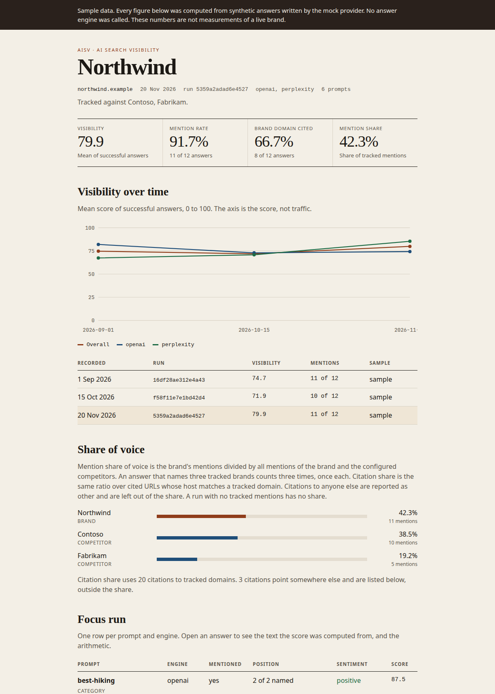

# aisv

[](https://github.com/photosnob/ai-search-visibility/actions/workflows/ci.yml)

Track whether AI answer engines mention, rank, and cite a brand.

`aisv` is a command-line tracker for AI Engine Optimization (AEO) and Generative Engine Optimization (GEO). You give it a brand, the competitors you care about, and the prompts buyers actually ask. It queries answer engines, scores each reply, and stores the run so you can see whether visibility changed.

It is maintained by [John Shum](https://github.com/photosnob).

## Why this is an SEO problem

Classic rank tracking watches a page of links. A growing share of commercial questions are now answered inside the reply itself: ChatGPT, Perplexity, Gemini, Claude, and Google's AI Overviews. The click never happens, and a rank report does not show whether the brand was named, where it sat relative to competitors, how it was described, or which sources the model cited.

Those four facts are what a visibility program has to manage:

- Was the brand mentioned at all?
- Where was it placed, if the answer ranked anyone?
- Was the framing positive, neutral, or negative?
- Which URLs were cited, and were any of them yours?

`aisv` records them per prompt, per engine, per run. It does not estimate traffic or revenue, and it does not try to make a model mention you.

## Features

- OpenAI Responses API with the `web_search` tool, and the Perplexity Agent API with `web_search`. Both read API keys from the environment.
- A provider interface, so another engine is a new module and a `register()` call. Anthropic and Gemini are not built in.
- Mention detection, list rank, mention order, a small auditable sentiment lexicon, and citation hosts.
- Competitor share of voice, for mentions and for citations, kept separate from the visibility score.
- SQLite history. Each answer is stored as it finishes, including failures.
- A Markdown report, a single-file HTML report with an inline chart, and CSV extracts you can recompute by hand.
- `--dry-run` uses a deterministic mock provider. Tests and the sample report need no API keys.

## Quickstart

Requires Python 3.11+.

```bash
python -m pip install -e .
aisv init brand.yaml
# Put your brand, competitors, and prompts in brand.yaml.
aisv run --config brand.yaml --dry-run --db aisv.sqlite
aisv report --db aisv.sqlite --out report
```

Open `report/report.html`. A dry run is labeled sample data. It never calls an answer engine.

For a live run, copy `.env.example` to `.env` and set the keys you use. `aisv` loads `.env` from the working directory and does not override variables already in the shell.

```bash
cp .env.example .env
aisv run --config brand.yaml --db aisv.sqlite
aisv report --db aisv.sqlite --out report
```

One prompt is one request per provider. There are no retries. Check the provider's current pricing before a large run. `--limit 5` is a cheap smoke test.

Useful flags:

| Flag | What it does |
| --- | --- |
| `--providers openai,perplexity` | Override the config for this run |
| `--prompts prompts.csv` | Append prompts from a CSV (`id`, `text`, `category`) |
| `--prompt-id best-hiking` | Run one prompt. Repeat the flag for several |
| `--recorded-at 2026-11-01` | Store a specific date. Useful for backfills |
| `--mock-seed 2` | A different, repeatable set of synthetic answers |
| `--report out/` | Write the report at the end of `aisv run` |
| `--quiet` | Hide per-prompt progress |

`aisv runs` lists what is in the database. `aisv providers` lists engines.

## Sample output

The committed report is labeled Sample data and is generated from [`examples/northwind.yaml`](examples/northwind.yaml) by the mock provider. Northwind, Contoso, and Fabrikam are fictional, and `.example` is a reserved TLD. The columns are labeled `openai` and `perplexity` because a dry run keeps the provider names from the config; the model on every row is `mock`. The figures below are measurements of those synthetic sentences. They are not measurements of a live brand, and they are not a benchmark.

Regenerate it with:

```bash
python examples/render_sample.py
```

That writes three runs (1 Sep 2026, 15 Oct 2026, 20 Nov 2026) using mock seeds 1, 2, and 3. `aisv runs` on that database prints:

```text
2026-09-01T00:00:00Z  …  Northwind  74.7  sample
2026-10-15T00:00:00Z  …  Northwind  71.9  sample
2026-11-20T00:00:00Z  …  Northwind  79.9  sample
```

The focus run, 20 Nov 2026, scored **79.9** visibility, mentioned the brand in **11 of 12** answers (91.7%), cited `northwind.example` in **8 of 12** (66.7%), and had a **42.3%** mention share of voice against Contoso and Fabrikam.



The same history as text:

```text
2026-09-01       Overall     ███████░░░   74.7
2026-10-15       Overall     ███████░░░   71.9
2026-11-20       Overall     ████████░░   79.9
2026-09-01       openai      ████████░░   82.0
2026-10-15       openai      ███████░░░   72.9
2026-11-20       openai      ███████░░░   74.3
2026-09-01       perplexity  ███████░░░   67.4
2026-10-15       perplexity  ███████░░░   70.8
2026-11-20       perplexity  █████████░   85.4
```

Two rows from that focus run show the range. On "Where should I look for repairable outdoor clothing?", both mock engines ranked Northwind first of three, with positive sentiment and a citation of the brand domain, which scores 100.0. On "Which sustainable rain jacket brands are worth buying?", the OpenAI-labeled mock answer named only the competitors and scored 0.0. The full table, the answer text, and the arithmetic for every row are in [`examples/sample-report/report.md`](examples/sample-report/report.md). `answers.csv` next to it has the components, so the score can be recomputed without trusting the report.

## How scoring works

Each successful answer is scored from 0 to 100. The score is 100 × (mention × 0.40 + position × 0.25 + sentiment × 0.20 + citation × 0.15). Mention is 1 when the brand name or an alias appears as a whole word, otherwise 0. Position is (N − rank + 1) / N when the brand is placed in a list of N items or among N tracked names in prose; a mention that is not ranked scores 0.5. Sentiment uses the sentences that name the brand: positive 1, neutral 0.6, negative 0.2, and 0 when the brand is absent. Citation is 1 when a cited host is the brand domain, 0.4 when the brand is mentioned but not cited, and 0 otherwise. Share of voice is separate and is not part of this score.

Mention, position, sentiment, and citation components are rounded to 6 decimal places before weighting. The weighted sum is multiplied by 100 and rounded half up to 1 decimal place. answers.csv stores the components, so the score can be recomputed from the file.

Mention share of voice is the brand's mentions divided by all mentions of the brand and the configured competitors. An answer that names three tracked brands counts three times, once each. Citation share is the same ratio over cited URLs whose host matches a tracked domain. Citations to anyone else are reported as other and are left out of the share. A run with no tracked mentions has no share.

Answers that fail, including timeouts and HTTP errors, are stored with the error and left out of averages, mention rate, and share of voice. An outage is not treated as a visibility of zero.

A few judgments sit under that contract:

- A numbered or bulleted list of at least two items is read top to bottom as a ranking. Bullets are treated as ordered because answer engines usually put the preferred option first. That reading is wrong when the list is genuinely unordered.
- A name that appears only outside that list counts as a mention with no rank (position component 0.5), not as rank 1.
- With no list, two or more tracked names are ranked by which appears first. A lone mention is unranked.
- Sentiment is a lexicon in `src/aisv/lexicon.py`, plus a three-word negation window (`not reliable` flips). Above 0.2 is positive, below −0.2 is negative, and the middle, including no polarity words, is neutral. Sarcasm and mixed reviews will be wrong sometimes. It is not a trained classifier.
- Host matching is a suffix check. `shop.brand.example` belongs to `brand.example`. `brand.example.evil.test` does not. URLs are removed before mention detection, so a cited host is not also counted as the brand name being said.
- The prompt is sent as you wrote it. The instructions do not name the brand. Only the mock provider sees the brand list, and only so it can write synthetic sentences for the analyzer.

The report prints this same text, generated from the constants in `src/aisv/scoring.py`.

## Configuration

```yaml
brand:
  name: Northwind
  domain: northwind.example   # bare host, no scheme, no path
  aliases:
    - Northwind Outfitters

competitors:
  - name: Contoso
    domain: contoso.example

prompts:
  - id: best-hiking
    category: category
    text: What are the best hiking apparel brands for weekend trips?

prompts_file: prompts.csv     # optional, resolved next to the YAML

providers:
  - openai
  - perplexity

settings:
  timeout_seconds: 90
```

Aliases are matched as whole words. A short alias such as `NW` will false-positive. Domains are stored without a leading `www.`.

CSV prompts need a header row and a `text` column. `id` and `category` are optional.

```csv
id,text,category
repair-shops,Who repairs outdoor jackets after a season of use?,consideration
```

See [`examples/northwind.yaml`](examples/northwind.yaml) and [`examples/prompts.csv`](examples/prompts.csv).

## Providers

| Name | Endpoint | Key |
| --- | --- | --- |
| `openai` | `POST https://api.openai.com/v1/responses` with the `web_search` tool | `OPENAI_API_KEY` |
| `perplexity` | `POST https://api.perplexity.ai/v1/agent` with the `web_search` tool | `PERPLEXITY_API_KEY` |
| `mock` | No network | none |

OpenAI defaults to `gpt-6.2-astra`, which is the model in OpenAI's web-search guide. Override it with `AISV_OPENAI_MODEL`. The model may answer without searching; `aisv` records the text and citations it actually returned.

Perplexity defaults to `effort: fast` and does not pin a third-party model, so the thing being measured is Perplexity's own grounded search. Set `AISV_PERPLEXITY_MODEL` to pin a model instead. `AISV_PERPLEXITY_EFFORT` selects `fast`, `low`, `medium`, or `high`.

Base URLs are overridable with `AISV_OPENAI_BASE_URL` and `AISV_PERPLEXITY_BASE_URL`, which is the supported way to point at a proxy. The legacy Sonar response shape is still parsed if a proxy returns it.

To add an engine, implement `ask(prompt) -> ProviderResponse` and register it:

```python
from aisv.models import ProviderResponse
from aisv.providers.base import ProviderContext
from aisv.providers.registry import register


class MyEngine:
    def __init__(self, name: str) -> None:
        self._name = name

    @property
    def name(self) -> str:
        return self._name

    @property
    def model(self) -> str:
        return "my-engine-1"

    def ask(self, prompt: str) -> ProviderResponse:
        return ProviderResponse(provider=self._name, model=self.model, text="…", citations=())


def factory(ctx: ProviderContext) -> MyEngine:
    return MyEngine(ctx.recorded_name)


register("myengine", factory, "One-line description for `aisv providers`.")
```

Call `register` before `aisv run` builds providers, or add the import to `src/aisv/providers/registry.py` next to the built-ins. Do not put the brand name in the prompt you send. The measurement is only useful if the engine was not told who you hoped to find.

## Storage

The default database is `aisv.sqlite` in the working directory. It is gitignored. Delete the file to drop history.

A run is a new row, not an update. Interrupted runs keep the answers that already finished; the rest are simply absent. Failed answers are stored with the error text and a null score. Request headers are not stored. HTTP error bodies are truncated, and strings that look like API keys are redacted before the error is saved.

`aisv report` writes:

| File | Contents |
| --- | --- |
| `report.md` | The brief, including answer text and the formula for each row |
| `report.html` | The same brief, with an inline SVG chart. No JavaScript, no network |
| `visibility.svg` | The chart, when Markdown is requested |
| `answers.csv` | Every answer in the history, with score components |
| `sources.csv` | Every citation |
| `mentions.csv` | Every tracked name, mentioned or not |

Pass `--run <id>` to focus the tables on one run. The chart still includes that brand's other runs. Pass `--brand` when the database holds more than one brand. The brand name is the identity of a history.

## Development

```bash
python -m pip install -e ".[dev]"
ruff check .
ruff format --check .
mypy
pytest
```

CI runs those on Python 3.11, 3.12, and 3.13. A test rebuilds the sample and checks that `examples/sample-report/answers.csv` still matches, and that every stored score recomputes from its components.

## Roadmap

- Anthropic and Gemini providers on the same interface.
- A diff between two runs: prompts gained, lost, and reordered.
- Prompt tags, so a report can be sliced by category without a spreadsheet.
- Citation-span sentiment, limited to the sentence a citation supports.

Scheduling stays outside the tool. Cron, or whatever runner you already trust, can call `aisv run`.

## License

MIT. See [LICENSE](LICENSE).
